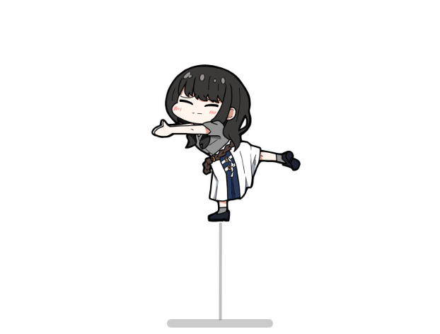
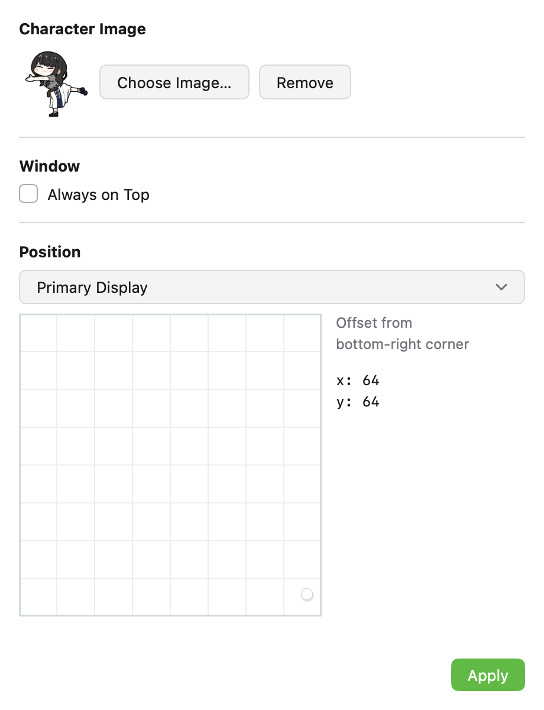

# Sakana

A desktop pet for macOS — a little fish (or your own character) that sways and bounces on your screen. Inspired by [sakana-widget](https://github.com/dsrkafuu/sakana-widget).



Written in Go with [Mygo](https://mygo.egoist.dev): one small binary, a native
UI drawn on the GPU, no webview and no Xcode. The pet floats in a transparent,
non-activating panel — it shows on every Space and over full-screen apps, and
clicking it does not take the frontmost app's place.

## Features

- Physics-based swaying animation with spring dynamics
- Custom character image support
- Always-on-top or normal window level
- Multi-screen placement
- Drag-to-interact — grab and pull the character
- Menu bar app with no Dock icon

## Requirements

- macOS 12+
- Go 1.27+

## Build & Run

```sh
go run .                # run from source
go tool mygo build      # package build/darwin-arm64/Sakana.app (+ .dmg)
go build ./...          # compile only
```

`tools/e2e.sh` is the test: it launches the app with a control socket, checks
the window, viewport, spring and settings behavior, captures PNGs, packages the
app and verifies the bundle. Its report lands in `artifacts/e2e/report.md`.

## Settings



Click the menu bar fish icon → **Settings…** (⌘,) to configure:

- **Character Image** — choose a custom PNG/JPEG, or remove to use the default
- **Window** — toggle always-on-top
- **Position** — pick a screen and drag the handle to set the distance from its
  bottom-right corner; **Apply** moves the pet

Settings live in `~/Library/Application Support/Sakana/settings.json`.

## Project layout

- `main.go` — app lifecycle, the pet window, the menu bar item, wiring
- `internal/pet` — spring physics, viewport metrics, the native-UI widget, image loading
- `internal/settings` — the settings store and the settings window
- `internal/e2e`, `tools/e2e.sh` — the end-to-end harness

## License

MIT
